# Feature Map — Web Admin Console (`apps/web`)

Admin console for the check-wallet backend: admin API-key login +
transaction-provider config management (list / edit / audit history).
React 19 + TypeScript strict + Vite 8 + Tailwind v4 (radix-nova
component library, copied — not generated).

- **Routes**: `/login`, `/providers`, `/providers/:code`
- **Backend**: same-origin `/api/*` → proxied to `http://localhost:8010`
  by Vite dev server (`vite.config.ts` `server.proxy`). No CORS.
- **Auth**: username+password → `POST /api/v1/auth/login` → HS256 JWT,
  sent as `Authorization: Bearer <token>` on every request. Admin role
  (`admin`/`superadmin`) required for `/api/v1/admin/*`. Token lives in
  `sessionStorage["cw.admin.token"]` only — never localStorage, cookies,
  URLs, or logs. `X-API-Key` remains valid for programmatic `api_clients`
  (partner API access) — the console itself uses only JWT.

---

## 1. Runbook — Step-by-Step Illustrated Guide

### 1.1 Prerequisites

```bash
# backend deps (Postgres :5433, Redis :6380) — already running if
# `docker ps` shows api-postgres-1 / api-redis-1 healthy
make -C apps/api deps-up
cd apps/api && go run ./cmd/api        # API on :8010
cd apps/web && npm install && npm run dev   # SPA on :5173
```

### 1.2 Sign in (admin account)

`GET /` redirects to `/login` when no session token is stored.

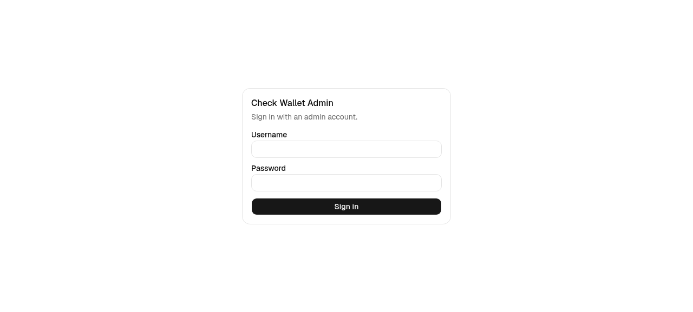

Sign in with a `system_users` account. On first boot the backend seeds
a **`superadmin`** account with a random password — printed once in the
API log (`BOOTSTRAP superadmin created — store this password`). More
users are provisioned via `POST /api/v1/admin/system-users` (superadmin
only) — there is no self-signup.

The client posts `{username, password}` to `POST /api/v1/auth/login`:

| Server response | UI result |
|---|---|
| `200` | `{token, user}` stored in sessionStorage → `/providers`; header shows the username |
| `401 INVALID_CREDENTIALS` | inline **"Invalid username or password."** — stays on `/login` |
| `400` | inline server message — stays on `/login` |
| 5xx/network | retryable error state |

Wrong credentials:

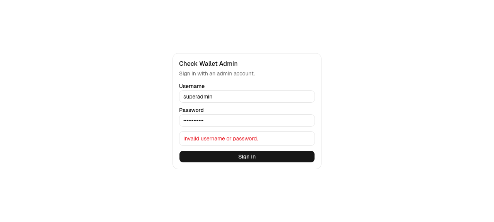

> The login call passes `skipUnauthorizedHandler` — a failed login does
> NOT trigger the "session expired" redirect. Verified.

Header after login shows the session user (`session-user` testid) next
to Logout:

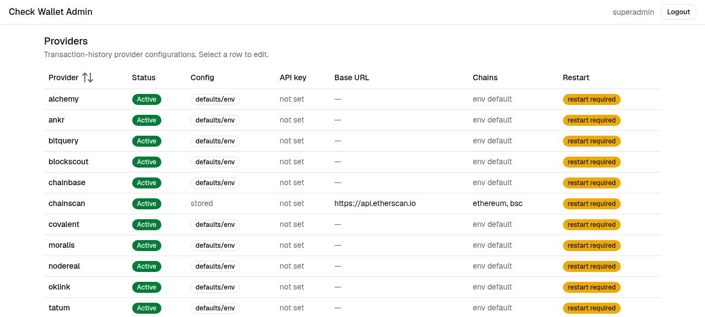

### 1.3 Provider list — `/providers`

All 12 registered tx-provider codes with real backend data:

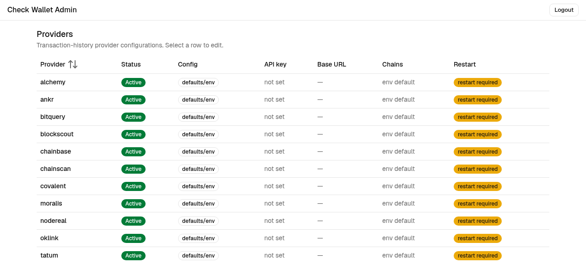

Column semantics:

| Column | Rule |
|---|---|
| Status | `effective_active` → Active/Inactive badge |
| Config | `configured:false` → `defaults/env` (no DB row; env/defaults in effect) |
| API key | masked — `••••<last4>` or `not set`; plaintext never rendered |
| Base URL | stored URL or `—` |
| Chains | `null` → `env default`; `[]` → `[]`; else list |
| Restart | `requires_restart.length>0` → persistent `restart required` badge |

### 1.4 Provider detail — `/providers/chainscan`

Configured `chainscan` after the writes below: `restart required`
badge persists, `api_key` input shows placeholder `not set`
(write-only — **never prefilled**), `base_url` shows the stored
value with a `Clear` button, both chains checked (explicit
`[ethereum, bsc]`).

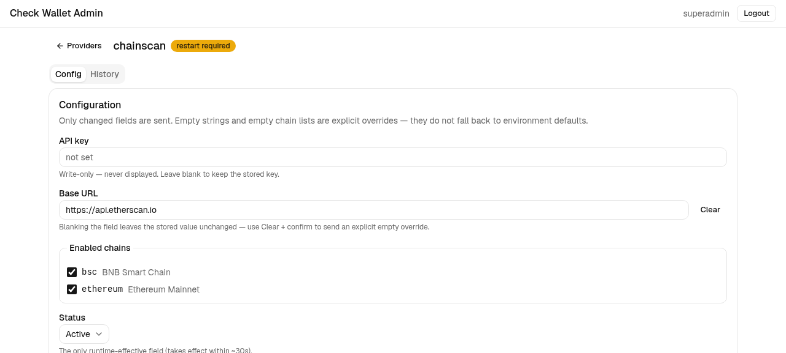

**PATCH discipline (the core invariant):** the PUT body contains
**only dirty fields**. Blanking an input ≠ clearing — clearing
requires the explicit **Clear** action + confirm dialog. `""`/`[]`
are explicit overrides (no env fallback); an absent key leaves the
column untouched.

**Field error surface (400):** a non-allowlisted host returns
`error.allowed_hosts`, rendered next to the field:

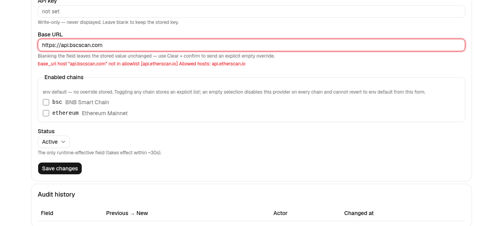

**Post-save warnings:** `requires_restart` renders as a warning note
(stored ≠ in-effect until API restart — only `status` is
runtime-effective, TTL ~30 s):

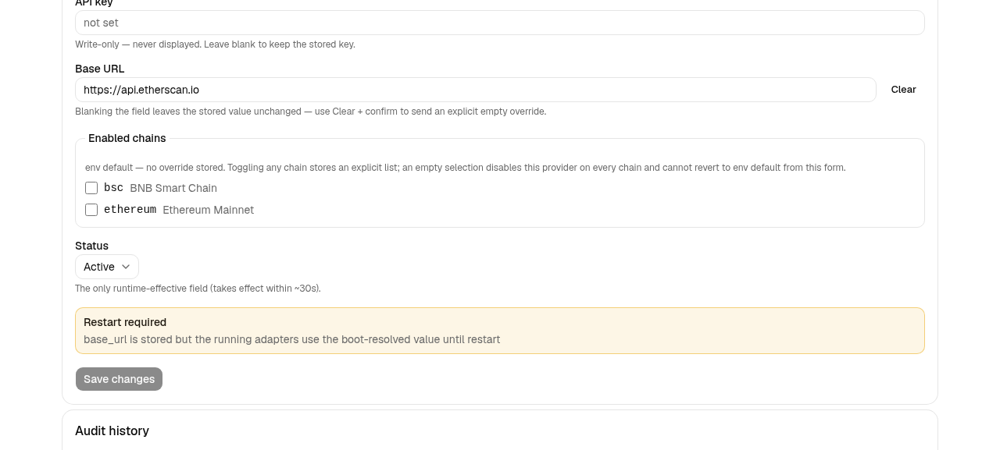

### 1.5 Explicit clear + empty chains (confirm-gated overrides)

`base_url` Clear opens a ConfirmDialog spelling out the semantics:

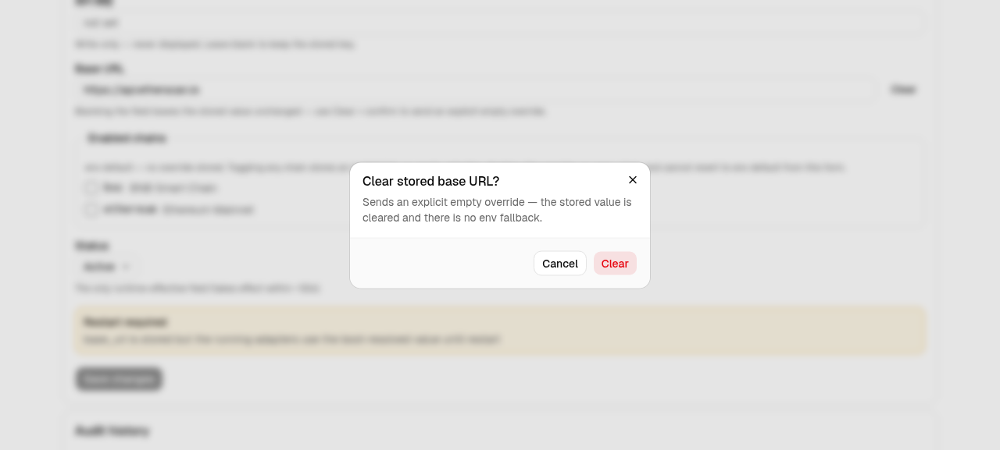

Unchecking the **last** enabled chain opens the destructive confirm —
`enabled_chains: []` disables the provider on every chain and cannot
revert to env default from this form (one-way by contract):

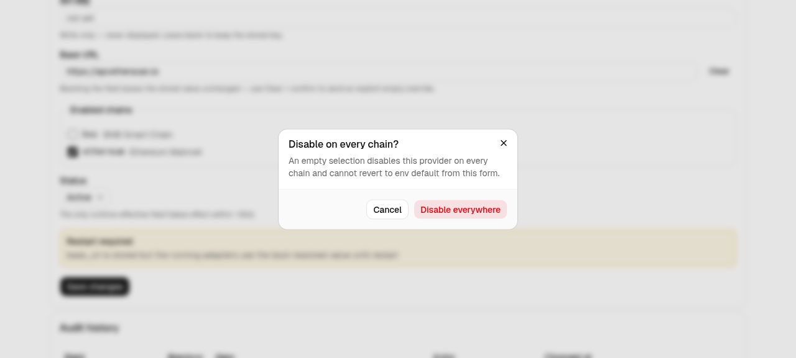

After saving `[]`, both warning severities render — destructive
`no_enabled_chains` + warning `requires_restart`:

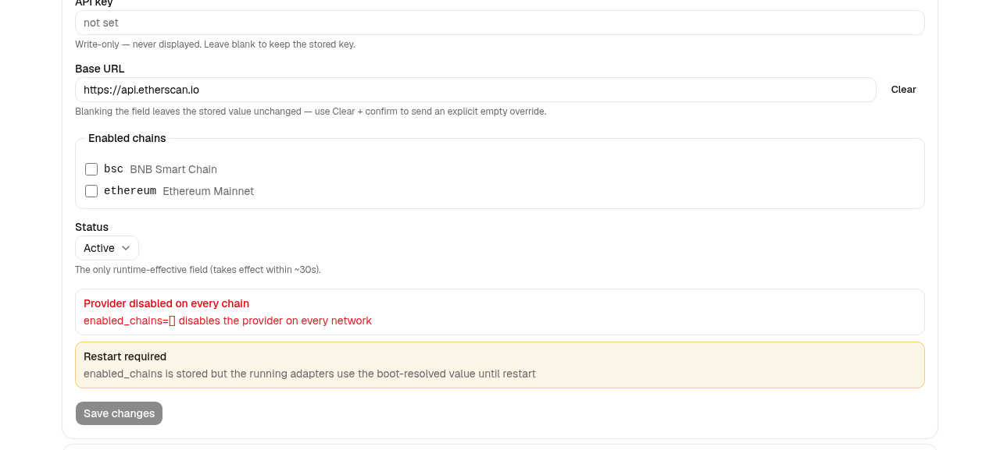

### 1.6 Audit history — History tab

`GET /api/v1/admin/provider-configs/chainscan/changes?limit=50` —
keyset-paginated, newest-first. `api_key` rows render the masked
`{set,last4}` shape, never raw. `actor_id: null` → `—`.
"Load more" appears only while `next_cursor` is non-empty.

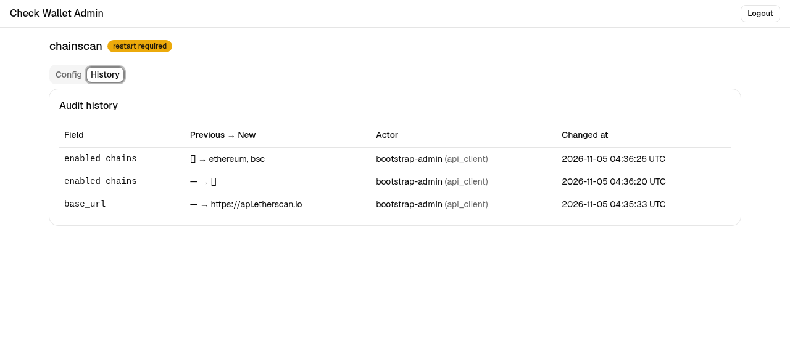

### 1.7 Session expiry & logout

A mid-session `401` (e.g. revoked key) clears the stored key and
redirects to `/login?reason=session_expired` with a notice:

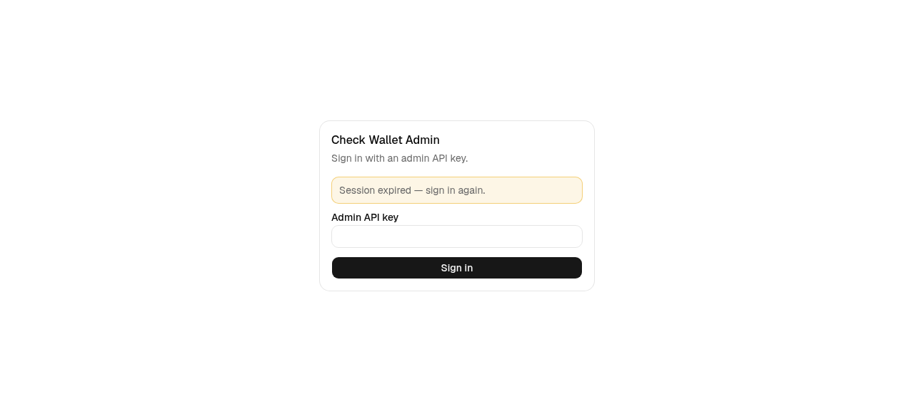

**Logout** (header button) clears sessionStorage + router state →
`/login`.

### 1.8 Verifying writes in the database

Every UI write is auditable in Postgres:

```bash
docker exec api-postgres-1 psql -U wallet -d check_wallet -c \
  "SELECT source_code, base_url, enabled_chains, status, updated_by
   FROM provider_configs WHERE source_code='chainscan'"
```

```text
 source_code |         base_url         |  enabled_chains  | status |   updated_by
-------------+------------------------+------------------+--------+-----------------
 chainscan   | https://api.etherscan.io | {ethereum,bsc}   | active | bootstrap-admin
```

```bash
docker exec api-postgres-1 psql -U wallet -d check_wallet -c \
  "SELECT field, previous_value, new_value, actor_id, actor_type,
          changed_at FROM provider_config_changes
   WHERE source_code='chainscan' ORDER BY changed_at"
```

```text
     field      | previous_value |         new_value          |    actor_id     | actor_type |          changed_at
----------------+----------------+----------------------------+-----------------+------------+-------------------------------
 base_url       | null           | "https://api.etherscan.io" | bootstrap-admin | api_client | 2026-11-05 04:35:33.436808+00
 enabled_chains | null           | []                         | bootstrap-admin | api_client | 2026-11-05 04:36:20.1653+00
 enabled_chains | []             | ["ethereum", "bsc"]        | bootstrap-admin | api_client | 2026-11-05 04:36:26.565213+00
```

These rows were produced by the UI flow above — History tab renders
the same data masked (`—` for null). Mutations made via a JWT session
record `actor_type = system_user` / `actor_id = <username>`; API-key
clients record `api_client` as before.

---

## 2. Technical Feature Map

### 2.1 Source paths

| Concern | File |
|---|---|
| Entry / router | `src/main.tsx`, `src/App.tsx` |
| App shell (header, logout) | `src/app-shell.tsx` |
| Auth boundary | `src/lib/auth.ts` (sessionStorage store), `src/auth/auth-context.tsx`, `src/auth/auth-guard.tsx` |
| API layer | `src/lib/api.ts` (`apiFetch`, `ApiError`, envelope unwrap, `onUnauthorized`, `skipUnauthorizedHandler`), `src/lib/types.ts` |
| Login | `src/features/login/login-page.tsx` |
| Provider list | `src/features/providers/providers-page.tsx`, `columns.tsx` |
| Provider detail | `src/features/providers/provider-detail-page.tsx` (tabs + `historyActivated` latch) |
| Config form | `src/features/providers/provider-config-form.tsx` |
| PATCH semantics | `src/features/providers/patch.ts` (`buildPatch`, `chainsEqual` — pure, property-tested) |
| History | `src/features/providers/provider-history.tsx` (`formatChangeValue`) |
| Confirm dialogs | `src/components/confirm-dialog.tsx` (composes vendored `Dialog`) |
| Vendored library | `src/components/**` — byte-identical to `/home/lethanhlam/Desktop/Profile/component` |
| Tests | `tests/{api,auth,providers-list,provider-form,history}.*`, `tests/blind/saturation.test.tsx`, `tests/helpers/gen.ts` |

### 2.2 API contract consumed

| Endpoint | Usage |
|---|---|
| `POST /api/v1/auth/login` | public — issues Bearer JWT for system users |
| `GET/POST /api/v1/admin/system-users` | superadmin only — list/provision console users |
| `GET /api/v1/admin/provider-configs` | list page |
| `GET /api/v1/admin/provider-configs/{code}` | detail page view |
| `PUT /api/v1/admin/provider-configs/{code}` | save — body = dirty fields only; `{data, warnings?}` |
| `POST /api/v1/admin/provider-configs/{code}/test` | live probe of stored config — `{network, address}` → `{ok, latency_ms, head_block, transfers_seen, error_kind?, http_status}`; failure is a status field, never 500 |
| `GET /api/v1/admin/provider-configs/{code}/changes?cursor&limit` | history keyset pages (`limit=50`) |
| `GET /api/v1/networks` | `enabled_chains` checkbox options |

Envelope: success `{data}` (+ `warnings[]` on PUT); error
`{error:{code,message,request_id,allowed_hosts?}}` — `allowed_hosts`
surfaced on `400` next to `base_url`.

### 2.3 DOM anchors (`data-testid`)

| Area | Test IDs |
|---|---|
| Login | `login-form`, `login-username-input`, `login-password-input`, `login-submit`, `login-error` |
| Shell | `app-header`, `session-user`, `logout-button` |
| List | `providers-table`, `provider-row-<code>`, `restart-badge`, `restart-badge-<code>`, `datatable-skeleton-row` |
| Tabs | `provider-tabs`, `tab-config`, `tab-history`, `back-to-providers` |
| Form | `config-form`, `apikey-input`, `field-error-api_key`, `baseurl-input`, `baseurl-clear`, `field-error-base_url`, `chains-fieldset`, `chain-check-<network>`, `status-select`, `save-button`, `form-error`, `warnings-region`, `warning-<code>` |
| History | `history-table`, `history-empty`, `load-more` |
| Probe | `test-form`, `test-network-select`, `test-address-input`, `test-run-button`, `test-result`, `test-result-ok`, `test-result-fail`, `test-error` |

### 2.4 Keyboard / a11y

- `Enter` submits the login form (native `type="submit"`).
- `Esc` closes ConfirmDialog (Radix Dialog default).
- `←`/`→` move between Config/History tabs (Radix Tabs default).
- Dialogs trap focus; `aria-invalid` set on rejected inputs.

### 2.5 State model

- `token`/`user` — `sessionStorage["cw.admin.token"]` +
  `["cw.admin.user"]` (JSON `{username, role}`), mirrored in
  `AuthContext`; `401` (non-login) → `sessionExpired` flag →
  atomic guard redirect (no navigate/clear race).
- Form field state — `{untouched|set|cleared}` per field in
  `patch.ts`; `buildPatch` elides `set` values equal to stored
  (set-equality for chains); fully-elided ⇒ `patchEmpty` ⇒ Save
  disabled ⇒ zero requests.
- Tabs — `forceMount` both panels; `historyActivated` latched
  once-true on first History activation (lazy fetch).

### 2.6 Known quirks (for future pages)

- **radix-ui 1.8 `forceMount` visibility**: a forceMounted
  `TabsContent` stays `display:block` when inactive (`hidden` is NOT
  applied). Always pair `forceMount` with
  `className="data-[state=inactive]:hidden"` — pinned by test
  (`tests/history.test.tsx` › "hides inactive tabpanels").
- `agent-browser fill "<sel>" ""` does not clear inputs — use
  focus + `Control+a` + `Backspace`.
- `api_key` is two-state (`untouched|set`) — no Clear affordance;
  `""` semantics for keys are undefined by contract.
- `enabled_chains` `[]`→`null` (restore env default) is impossible
  via PATCH — UI copy states the one-way asymmetry.
- `requires_restart` (view field) ≠ `requires_restart` (warning
  code) — badge vs post-write warning; keep distinct.
